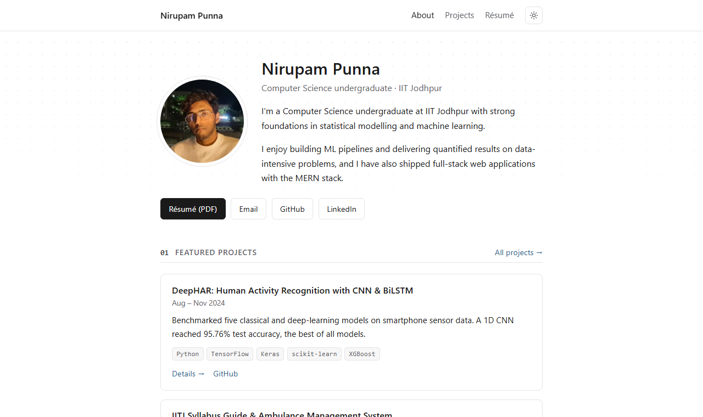

<div align="center">

# Nirupam Punna

Computer Science undergraduate at **IIT Jodhpur** · Machine Learning · Full-Stack Development

**[asta1729.github.io](https://asta1729.github.io)**

[Projects](https://asta1729.github.io/projects) · [Résumé](https://asta1729.github.io/resume) ·
[LinkedIn](https://www.linkedin.com/in/nirupampunna/) · [Email](mailto:punna.1@iitj.ac.in)

</div>

<br>



## About this site

This repository holds the source of my personal portfolio: a short introduction, my projects with detailed write-ups,
and my résumé. It is a fast, static site with no tracking, light and dark themes, and a layout that works on mobile.

| Page                                                 | What's there                                             |
| ---------------------------------------------------- | -------------------------------------------------------- |
| [About](https://asta1729.github.io)                  | Introduction, featured projects, education, skills, achievements |
| [Projects](https://asta1729.github.io/projects)      | All projects, each with its own detail page              |
| [Résumé](https://asta1729.github.io/resume)          | Résumé preview and PDF download                          |

## Built with

- **[Astro](https://astro.build)**: static site generator; every page is pre-rendered HTML
- **Plain CSS**: no UI framework, one stylesheet
- **GitHub Actions + GitHub Pages**: every push to `main` builds and deploys automatically

## Project structure

```text
src/
├── content/projects/   one Markdown file per project
├── data/site.ts        bio, links, education, skills, achievements
├── pages/              routes: /, /projects, /projects/[slug], /resume
├── layouts/            shared page shell (header, footer, theme toggle)
├── components/         project card
├── assets/             profile photo, résumé preview image
└── styles/global.css   all styling
public/                 résumé PDF, favicon
```

## Running locally

Requires Node.js 22 or newer.

```bash
npm install
npm run dev       # http://localhost:4321
npm run build     # production build into dist/
```

## Adding a project

Create a Markdown file in `src/content/projects/`. The file name becomes the URL (`my-project.md` → `/projects/my-project`).

```md
---
title: "My Project"
summary: "One or two sentences shown on the project card."
category: Project # or: Course Project
period: "Jan – Mar 2026" # optional
course: "Course Name (CODE)" # optional
tags: [Python, PyTorch]
github: https://github.com/Asta1729/my-project # optional
demo: https://example.com # optional
image: ./my-project.png # optional, placed next to the .md file
featured: true # show on the home page (top 3 by order)
order: 5 # lower numbers appear first
draft: false # true hides it from the site
---

## Overview

Full write-up: problem, approach, results, screenshots.
```

Commit and push to `main`, and the site updates in about a minute.

## Updating other content

| What                                  | Where                             |
| ------------------------------------- | --------------------------------- |
| Bio, links, education, skills, awards | `src/data/site.ts`                |
| Profile photo                         | `src/assets/profile.jpg`          |
| Résumé PDF                            | `public/Nirupam_Punna_Resume.pdf` |
| Résumé preview image                  | `src/assets/resume.png`           |
| Colours, fonts, spacing               | `src/styles/global.css`           |

> When replacing the résumé PDF, also update `src/assets/resume.png` (an image of page 1) so the preview matches.
